# HCS425 Distributed Key-Value System

A Java 21 Maven multi-module implementation of a multi-threaded TCP client/server key-value store with a JavaFX/AtlantaFX monitoring console, concurrency benchmark harness, and a bounded single-writer replication demonstration. The console provides a compact observability layout with metric cards, dense dark/light panels, live throughput/latency charts, health indicators, and operational activity tables.

This repository is the complete HCS425 submission project. It contains the source code, automated tests, runtime launchers, measured performance evidence, architecture diagrams, screenshots, technical report, and a NetBeans-compatible Maven reactor.

## Submission information

| Field | Details |
|---|---|
| Student | Ezekiel Rego |
| Registration number | M230913 |
| Course | HCS425 |

## What the system demonstrates

- Java TCP communication using `ServerSocket` and persistent UTF-8 `Socket` connections.
- Independent client handlers running in a bounded `ThreadPoolExecutor`.
- A shared `ConcurrentHashMap` store with `PUT`, `GET`, `DELETE`, and framed `LIST` operations.
- Connection, worker, request, latency, throughput, success, and failure metrics.
- Client timeouts, malformed-request handling, unexpected-disconnect cleanup, and overload rejection.
- A real TCP benchmark for 1, 2, 5, 10, and 20 concurrent clients.
- A JavaFX console that performs real operations without blocking the JavaFX Application Thread.
- A three-process replication demonstration with leader A and replicas B and C.

## Modules

| Module | Purpose |
|---|---|
| `shared` | UTF-8 line-framed protocol, request/response models, LIST framing |
| `server` | `ServerSocket`, bounded `ExecutorService`, `ConcurrentHashMap`, metrics and logs |
| `client` | Timeout-aware synchronous client and JavaFX-safe asynchronous facade |
| `replication` | Leader-coordinated asynchronous update propagation to two replicas |
| `benchmark` | Coordinated real-TCP 1/2/5/10/20-client benchmark |
| `desktop` | JavaFX dashboard with AtlantaFX 2.0.1 theme and live operational controls |

The root project is a Maven parent project. Build from the repository root so Maven builds modules in dependency order: `shared` → `server` → `client` → `replication` → `benchmark` → `desktop`.

## Requirements

For the supplied VPS setup, use Java JDK 21, Maven 3.8 or newer, Git, and a graphical display for the desktop console. JavaFX dependencies are resolved by Maven. On a headless Linux VPS, Xvfb is sufficient for automated launch and screenshots.

Check the environment before opening the project:

```bash
java -version
javac -version
mvn -version
```

## Open and run from Apache NetBeans

For browser access from a laptop, see the complete [remote desktop and NetBeans workflow](docs/testing/remote-desktop-netbeans.md). The underlying VNC/noVNC services remain localhost-only; the optional public address is protected by HTTPS and authentication.

The configured public desktop address is `https://desktop.techinn.co.zw/`; it requires authentication and becomes reachable after its DNS `A` record points to the VPS.

1. Start Apache NetBeans.
2. Select **File → Open Project**.
3. Choose the repository root, the directory containing the root `pom.xml`.
4. Allow NetBeans to resolve Maven dependencies and index the six modules.
5. Right-click the root project and choose **Build** or **Test**. The custom Maven actions in `nbactions.xml` provide `verify`, `test`, and `package` actions.

The safest way to launch long-running applications from NetBeans is the built-in terminal, because the scripts configure the correct multi-module classpaths and process lifecycle. Open **Window → IDE Tools → Terminal**, change to the repository root, and use one terminal tab per process.

Run the complete build and tests:

```bash
mvn clean verify
```

Run the desktop with its embedded local server:

```bash
./scripts/start-desktop.sh
```

On a normal desktop this uses the existing display. On a headless VPS, the script starts Xvfb automatically when `DISPLAY` is unset. To launch explicitly on a virtual display:

```bash
Xvfb :99 -screen 0 1280x800x24 -ac +extension GLX &
export DISPLAY=:99
./scripts/start-desktop.sh
```

The desktop starts an embedded server on `127.0.0.1:5050` by default. To run the server independently, use two terminal tabs:

```bash
# Terminal 1
./scripts/start-server.sh

# Terminal 2
HCS425_EMBEDDED=false ./scripts/start-desktop.sh
```

Do not run the root command `mvn javafx:run`; the JavaFX main class belongs to the `desktop` module. If launching directly with Maven, use:

```bash
mvn -pl desktop javafx:run -Dhcs425.embedded=true
```

Stop a running server, desktop, or cluster with `Ctrl+C`. Do not start the standalone server on port 5050 at the same time as the desktop's embedded server.

## Simple demonstration flow

1. Run `./scripts/start-desktop.sh`.
2. Open **Dashboard** and show live status, clients, requests, latency, throughput, activity, and health.
3. Open **Key-Value Store** and execute PUT, GET, LIST, and DELETE.
4. Open **Client Manager** and launch simulated clients.
5. Open **Performance Testing**, choose 1, 2, 5, 10, or 20 clients, and run a workload.
6. Open **Server Logs** to search or export events.
7. Open **Replication** when the three-process cluster is running.

The server listens on `127.0.0.1:5050` by default. Override with `HCS425_HOST`, `HCS425_PORT`, and `HCS425_WORKERS` for `start-server.sh`, or with `-Dhcs425.host=...`, `-Dhcs425.port=...`, and `-Dhcs425.workers=...` when launching Java directly.

The cluster demonstration uses:

```bash
./scripts/start-cluster.sh
# leader: 127.0.0.1:5050; replica B: 5051; replica C: 5052
```

Leave the cluster terminal running, then use another terminal to verify propagation:

```bash
printf 'PUT demo replicated-value\n' | nc -w 2 127.0.0.1 5050
sleep 1
printf 'GET demo\n' | nc -w 2 127.0.0.1 5051
printf 'GET demo\n' | nc -w 2 127.0.0.1 5052
```

Both replicas should return `OK VALUE replicated-value`. Cluster logs are written to `logs/node-A.log`, `logs/node-B.log`, and `logs/node-C.log`.

## Testing and performance workflow

Run all automated protocol, store, real TCP, concurrency, replication, benchmark-smoke, and desktop-resource tests:

```bash
mvn clean verify
```

Run the full measured fixed-total-workload benchmark:

```bash
./scripts/run-benchmarks.sh
```

This executes 2,000 total operations at 1, 2, 5, 10, and 20 clients using real TCP connections. It writes `results/csv/performance-results.csv` and the SVG charts in `results/charts/`. The CSV contains mean latency, median latency, p95 latency, throughput, speedup, efficiency, and errors.

Latest measured run on the VPS:

| Clients | Operations | Throughput ops/s | Mean ms | p95 ms | Speedup | Efficiency | Errors |
|---:|---:|---:|---:|---:|---:|---:|---:|
| 1 | 2,000 | 3,852.01 | 0.250 | 0.721 | 1.000x | 100.00% | 0 |
| 2 | 2,000 | 10,290.59 | 0.180 | 0.419 | 2.671x | 133.57% | 0 |
| 5 | 2,000 | 9,435.52 | 0.452 | 1.004 | 2.450x | 48.99% | 0 |
| 10 | 2,000 | 15,036.64 | 0.572 | 1.062 | 3.904x | 39.04% | 0 |
| 20 | 2,000 | 15,465.05 | 0.906 | 3.874 | 4.015x | 20.07% | 0 |

Run the unexpected-client-failure test:

```bash
./scripts/run-fault-test.sh
```

The harness aborts one socket while nine other clients continue, then connects a replacement client. Evidence is written to `results/csv/fault-tolerance.txt`.

For a focused module test, use Maven's module selector:

```bash
mvn -pl shared test
mvn -pl server -am test
mvn -pl client -am test
mvn -pl replication -am test
mvn -pl benchmark -am test
mvn -pl desktop -am test
```

The complete requirement-to-evidence mapping, including the advanced replication limitation, is in [requirements-coverage.md](docs/testing/requirements-coverage.md).

## Protocol

Commands are one UTF-8 line per request:

```text
PUT key value with spaces
GET key
DELETE key
LIST
PING
STATS
```

Keys cannot contain whitespace. PUT values may contain spaces but cannot contain a newline. LIST responses are framed as `OK LIST count`, exactly `count` base64-url encoded `ITEM` lines, and `END LIST`. See [protocol.md](docs/protocol/protocol.md).

Example exchange:

```text
PUT student01 Alice in Harare
OK STORED
GET student01
OK VALUE Alice in Harare
DELETE student01
OK DELETED
LIST
OK LIST 0
END LIST
```

A client may keep one connection open and send multiple commands. Malformed requests return an error response; idle clients are closed after the server read timeout.

## Architecture and synchronization

```text
JavaFX Client / Benchmark Clients
            │ persistent UTF-8 TCP
            ▼
       ServerSocket acceptor
            │
            ▼
 bounded ExecutorService workers
            │
            ▼
     Protocol parser/executor
            │
            ▼
 ConcurrentHashMap key-value store
```

The acceptor is separate from client workers. Each accepted connection is registered, assigned to the bounded pool, processed independently, and removed in a `finally` block. A slow, malformed, timed-out, or disconnected client does not terminate the server or stop unrelated workers. Basic map operations are thread-safe through `ConcurrentHashMap`; `LIST` creates a sorted snapshot instead of exposing live map state.

The advanced topology uses a single-writer leader:

```text
                 ┌──────────────┐
                 │ Server A     │
                 │ Leader       │
                 └──────┬───────┘
                        │ ordered async updates
                 ┌──────┴───────┐
                 ▼              ▼
          Server B         Server C
          Replica           Replica
```

Writes are acknowledged after the leader updates its local in-memory store and are then propagated with sequence numbers. This is eventual asynchronous replication, not quorum durability. Automatic leader election and network-partition resolution are intentionally not claimed.

## Evidence and submission files

Measured CSV output is written to `results/csv/performance-results.csv`, charts to `results/charts/`, screenshots to `results/screenshots/`, and the technical report to `docs/report/technical-report.md`. Requirement-by-requirement evidence is summarized in [requirements-coverage.md](docs/testing/requirements-coverage.md). The final NetBeans-openable package is placed in `submission/`.

Important submission files:

- [Technical report](docs/report/technical-report.md)
- [Protocol specification](docs/protocol/protocol.md)
- [Core architecture diagram](docs/architecture/architecture.svg)
- [Replication architecture diagram](docs/architecture/replication.svg)
- [Test evidence](docs/testing/test-evidence.md)
- [VPS environment record](docs/testing/vps-environment.md)
- [Open-source notices](LICENSES.md)
- [Submission ZIP](submission/hcs425-distributed-system.zip)

The ZIP excludes Maven `target/` directories, temporary logs, caches, and unrelated VPS files. Recreate it after changing evidence with:

```bash
zip -r -q -FS submission/hcs425-distributed-system.zip . \
  -x './.git/*' './*/target/*' './submission/*.zip' './logs/*' './*.log'
```

## Limitations

- The key-value store is in memory and is not durable across process restarts.
- Replication is single-writer asynchronous eventual consistency.
- Replica unavailability is logged while the leader continues local service.
- Automatic leader election, quorum commit, consensus, network-partition resolution, and automatic missed-update reconciliation are not implemented or claimed.
- Apache NetBeans 31 GUI opening was verified on the VPS display `:99` with JDK 21; the Maven reactor build, dependency resolution, tests, JavaFX launch, resources, and NetBeans Maven metadata were also verified.

## Screenshots

### Submission environment evidence

These two captures show the project opened in Apache NetBeans and the Maven verification completing successfully:

| Project opened | Build verification |
|---|---|
| [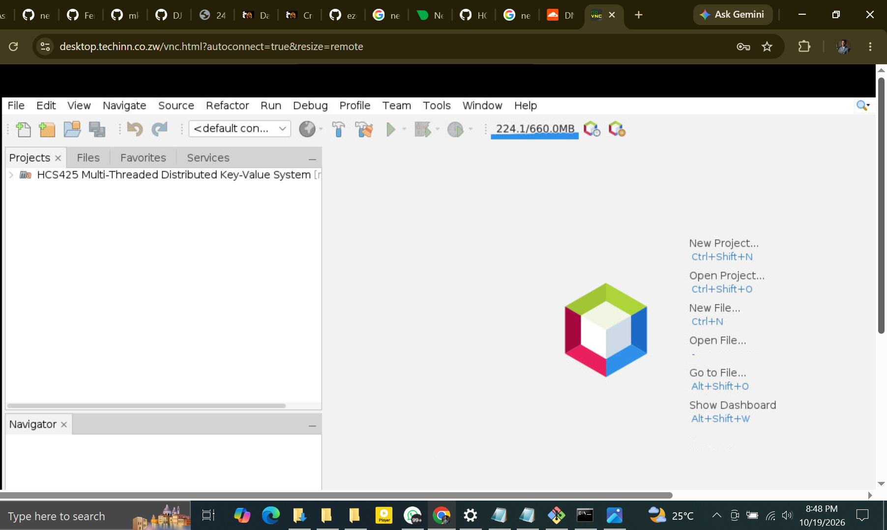](https://imglink.cc/cdn/8enQr1cRVX.png) | [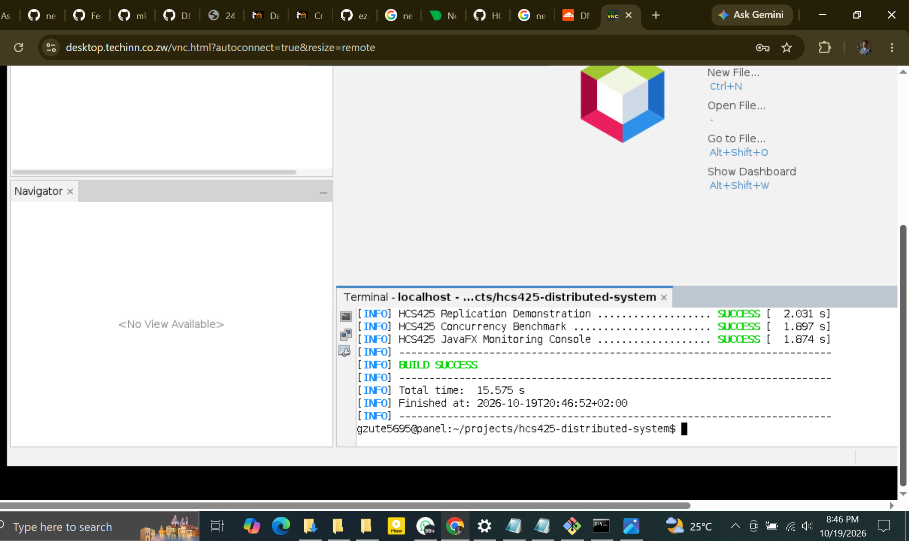](https://imglink.cc/cdn/5v4aDrlbGI.png) |

The following screenshots were captured from the running JavaFX application under Xvfb:

| Dashboard | Key-value operation | Performance results | Replication |
|---|---|---|---|
| [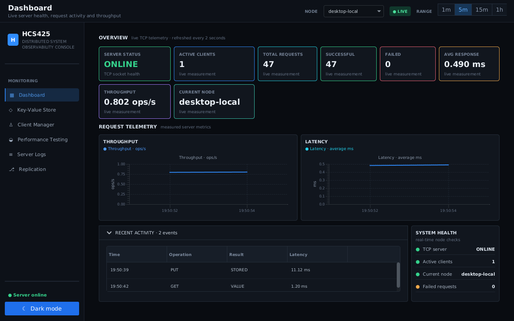](results/screenshots/dashboard-live.png) | [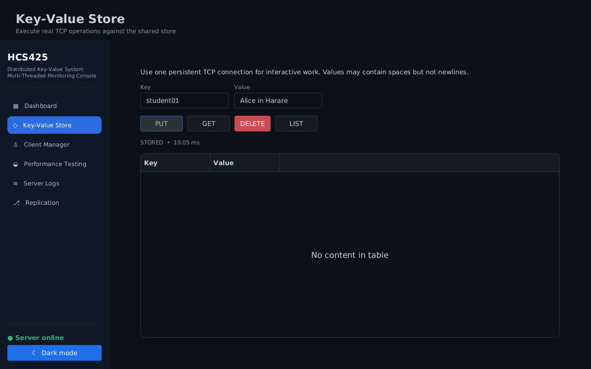](results/screenshots/put-operation.png) | [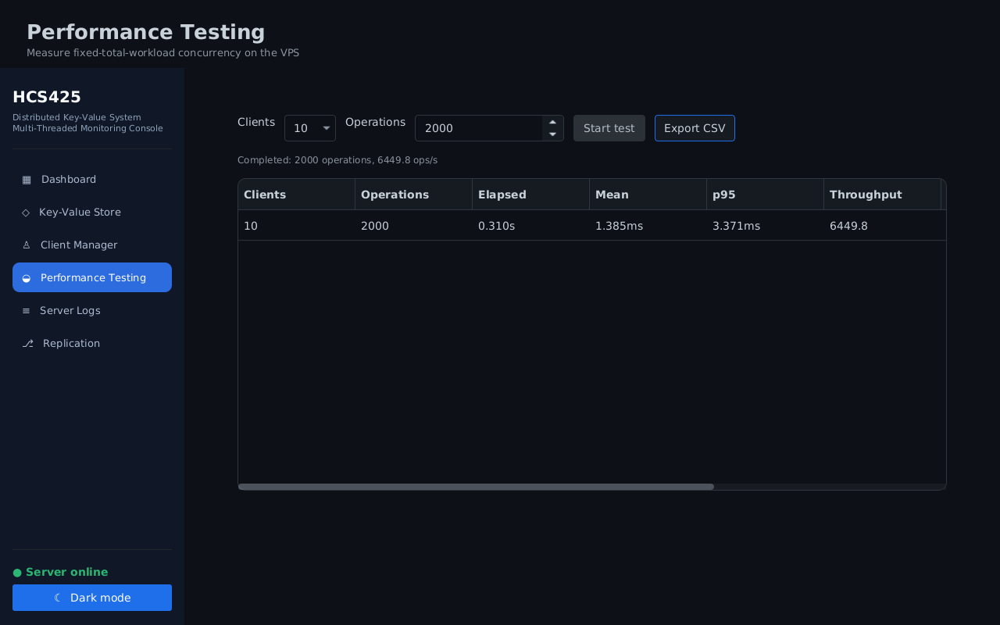](results/screenshots/performance-results.png) | [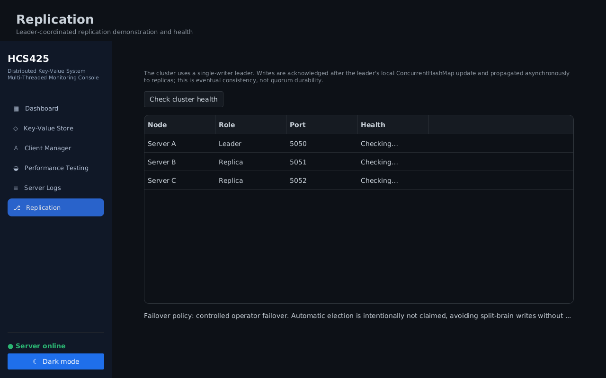](results/screenshots/replication.png) |

### Assignment evidence gallery

The gallery below makes the required implementation visible in the submission. Each image is a capture from the running JavaFX console; measured benchmark and fault-tolerance details are also linked in the evidence table.

#### Key-value operations

| PUT | GET | DELETE | LIST |
|---|---|---|---|
| [](results/screenshots/put-operation.png) | [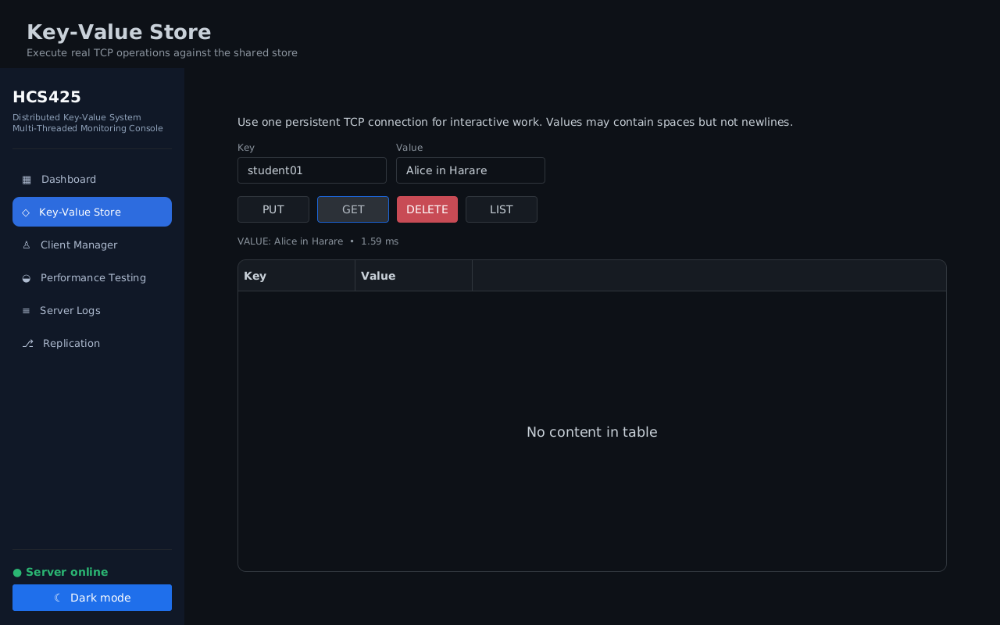](results/screenshots/get-operation.png) | [](results/screenshots/delete-operation.png) | [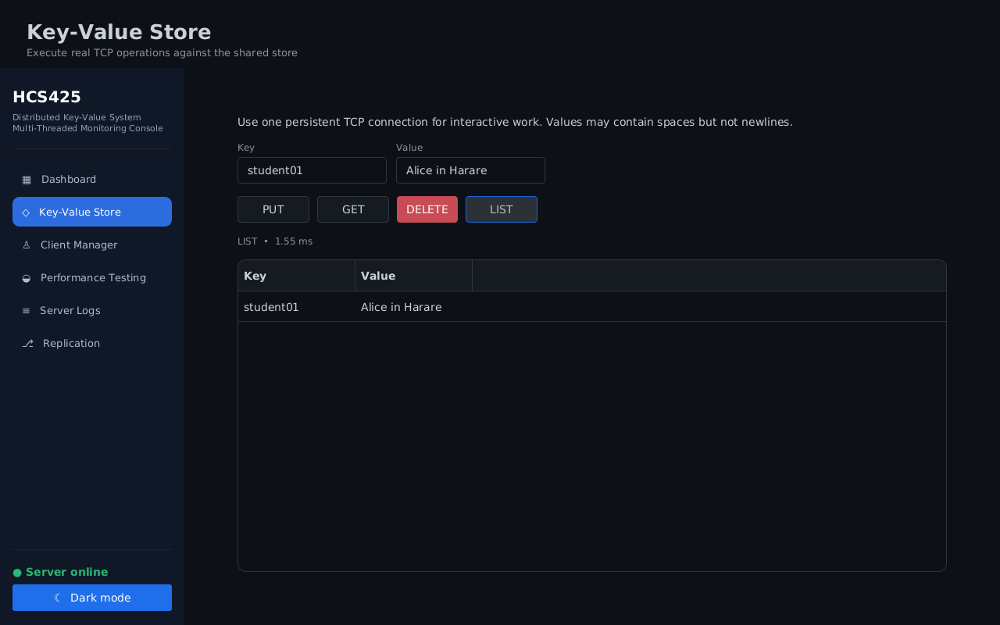](results/screenshots/list-operation.png) |

#### Monitoring and connected clients

| Dashboard | Key-value page | Connected clients | Server logs |
|---|---|---|---|
| [](results/screenshots/dashboard-live.png) | [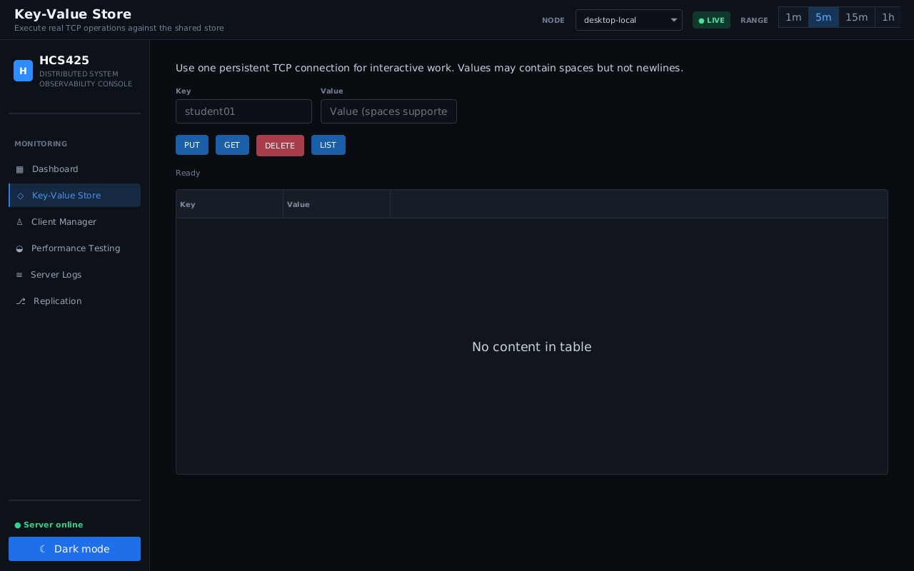](results/screenshots/key-value.png) | [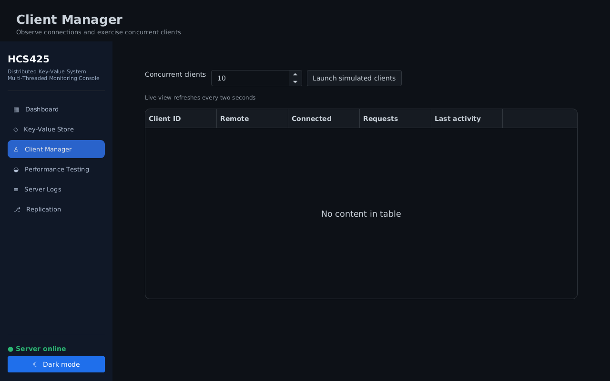](results/screenshots/client-manager.png) | [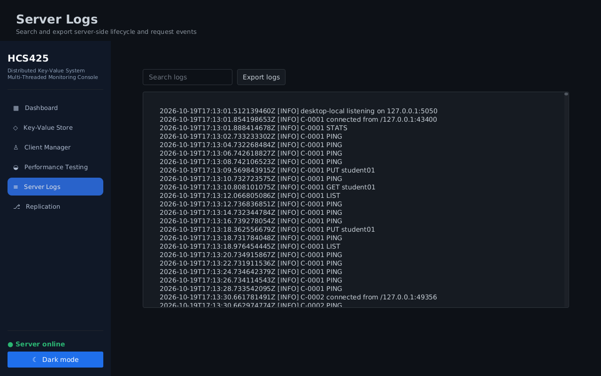](results/screenshots/server-logs.png) |

#### Concurrency, performance and replication

| Performance controls | Measured results | Replication monitor | Light theme |
|---|---|---|---|
| [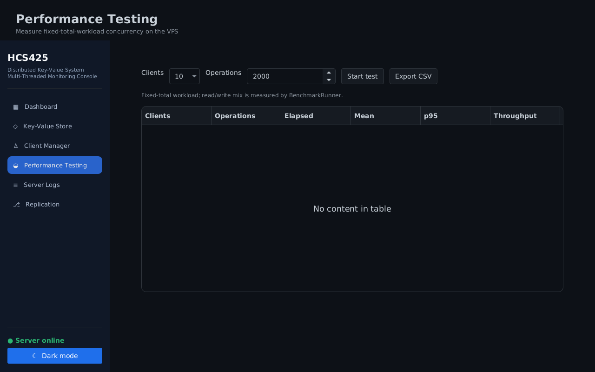](results/screenshots/performance-page.png) | [](results/screenshots/performance-results.png) | [](results/screenshots/replication.png) | [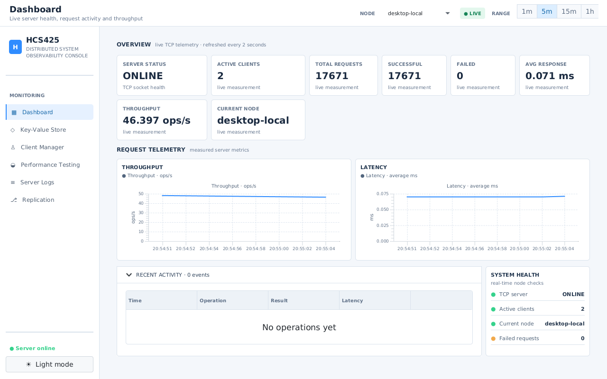](results/screenshots/light-mode.png) |

### Requirement-to-evidence map

| Assignment requirement | README evidence |
|---|---|
| TCP client-server communication and server status | [Dashboard](results/screenshots/dashboard-live.png), [key-value page](results/screenshots/key-value.png), [protocol specification](docs/protocol/protocol.md) |
| PUT, GET, DELETE and LIST operations | [PUT](results/screenshots/put-operation.png), [GET](results/screenshots/get-operation.png), [DELETE](results/screenshots/delete-operation.png), [LIST](results/screenshots/list-operation.png) |
| At least 10 simultaneous clients and 20-client test | [Client manager](results/screenshots/client-manager.png), [performance controls](results/screenshots/performance-page.png), [measured CSV](results/csv/performance-results.csv) |
| Threading, synchronization and race-condition protection | [Core architecture diagram](docs/architecture/architecture.svg), [requirements coverage](docs/testing/requirements-coverage.md), [test evidence](docs/testing/test-evidence.md) |
| Response time, throughput, speedup and efficiency | [Performance results](results/screenshots/performance-results.png), [performance CSV](results/csv/performance-results.csv), [technical report](docs/report/technical-report.md) |
| Malformed requests and failed-client cleanup | [Server logs](results/screenshots/server-logs.png), [fault-tolerance evidence](results/csv/fault-tolerance.txt) |
| Replicated servers and synchronization behavior | [Replication monitor](results/screenshots/replication.png), [replication diagram](docs/architecture/replication.svg), [replication evidence](results/csv/replication-evidence.txt) |
| Architecture and implementation explanation | [Architecture diagrams](docs/architecture/), [technical report](docs/report/technical-report.md) |
